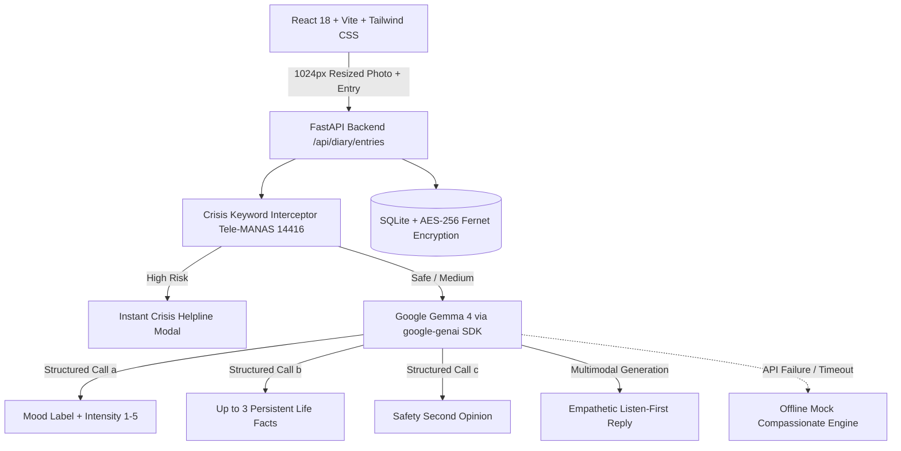

# Aaina (आईना) – An AI Diary That Listens, Remembers, and Replies
### *Powered by Google Gemma 4 (Open-Weight Model)*

> *"Loneliness is a silent epidemic. Aaina is the friend who remembers your day, reads your handwriting, and answers like someone who knows you."*

[-4285F4?style=for-the-badge&logo=google&logoColor=white)](https://ai.google.dev/)
[-34A853?style=for-the-badge&logo=googlelens&logoColor=white)](https://github.com/)
[](https://github.com/)
[](https://telemanas.mohfw.gov.in/)

---

## 1. Overview & Vision
**Aaina** (*"mirror"*) is an emotion-aware, multimodal AI diary companion powered by Google's open-weight **Gemma 4** architecture. Built for anyone who journals and desires genuine warmth and understanding rather than a cold, blank page.

Unlike traditional journaling apps or clinical chatbots, Aaina:
1. **Google Gemma 4 AI Companion:** Integrated via the `google-genai` Python SDK, reading `GEMINI_API_KEY` and `GEMMA_MODEL=gemma-4-26b-a4b-it`. Replies are warm, short, listen-first, and validate emotions before suggesting solutions.
2. **Multimodal Photo Diary:** Users can attach a photo of a handwritten diary page, a doodle, or a snapshot of their day. Resized on the client to max 1024px and passed directly to Gemma 4.
   - **Handwriting Recognition:** Gemma reads handwritten notes and treats them as the journal entry.
   - **Gentle Scene Connection:** For day photos or sketches, Gemma describes what it sees in one gentle sentence and connects it to the user's emotional state.
   - **Facial Privacy Guarantee:** Never infers emotions, character, demographics, or identity from human faces.
   - **Zero Storage of Photos:** Original images are discarded immediately after processing; only a small thumbnail is kept with the entry.
3. **Structured AI Tasks (Gemma 4):**
   - **Mood Sentiment & Intensity:** Classifies emotion (*calm, happy, sad, anxious, angry, tired, neutral*) with score (1–5).
   - **Memory Extraction:** Extracts up to 3 durable life facts (deadlines, routines, loved ones) per entry.
   - **Safety Second Opinion:** AI safety assessment (`low`, `medium`, `high`). Keyword crisis rules strictly override the model.
4. **Multilingual Empathy:** Natural responses in **English**, **Hinglish** (Roman script), and **Hindi** (Devanagari script).
5. **5 Persona Archetypes:** Choose your companion voice: *Caring Mom*, *Wise Dad*, *Best Friend*, *Partner*, or *Mentor*.
6. **The Circle:** Interactive concentric relationship map nudging users to stay connected with real-world friends and family.
7. **Family Care Link (Teen Protection):** For users aged 13–15, gently alerts parents or guardians when repeated strain is detected—**without ever leaking private diary text**.
8. **Interactive Mirror Reveal:** Erase frosted glass fog with your cursor or finger to see your reflection.
9. **Calm Ambient Writing Music:** Synthesized pure Web Audio API ambient soundscapes (*Soft pad*, *Rain*, *Warm drone*).
10. **Built-in Crisis Safety Layer:** Instant keyword interceptor connecting users immediately to national helplines (**Tele-MANAS: 14416** in India).

---

## 2. Architecture & Tech Stack



- **Frontend:** React 18, Vite, Tailwind CSS, Lucide React, Zustand, Recharts, Canvas image resizer, Web Speech API, Web Audio API synthesizer.
- **Backend:** Python 3.11+, FastAPI, SQLAlchemy 2.0, SQLite (`aaina.db`), Pydantic v2, Pillow 11.1 (thumbnailing), `cryptography` (Fernet AES-256), bcrypt, PyJWT.
- **AI Engine:**
  - Primary: Google Gemma 4 (`gemma-4-26b-a4b-it`) via `google-genai` SDK.
  - Automatic Fallback: Offline Rule-Based Mock Companion (visible UI notice, 0% crashes).

---

## 3. Quick Start & Run Instructions

### Prerequisites
- Python 3.11+
- Node.js v18+ and npm

### Step 1: Clone & Configure Environment Variables
```bash
# Clone the repository
git clone https://github.com/your-username/aaina.git
cd aaina

# Backend configuration
cd backend
cp .env.example .env
```

Open `backend/.env` and configure your keys:
```env
# AI Model Configuration
LLM_PROVIDER=gemma
GEMINI_API_KEY=your_gemini_api_key_here
GEMMA_MODEL=gemma-4-26b-a4b-it

# Security Keys
SECRET_KEY=your-secret-key-32-bytes-minimum
FERNET_KEY=your-fernet-key-base64-encoded
FRONTEND_ORIGIN=http://localhost:5173
DATABASE_URL=sqlite:///./aaina.db
```

> **Note:** If `GEMINI_API_KEY` is not provided or if the network is offline, Aaina **automatically and smoothly falls back** to the offline mock provider with a visible indicator in the UI.

### Step 2: Start the Backend Server
```bash
cd backend

# Create and activate virtual environment
python -m venv backend_venv
# Windows:
backend_venv\Scripts\activate
# Linux/macOS:
source backend_venv/bin/activate

# Install dependencies
pip install -r requirements.txt

# Seed demo accounts (adult and teen evaluation profiles)
python -m app.seed

# Start FastAPI server
uvicorn app.main:app --port 8000 --reload
```
The API is available at: `http://localhost:8000` (Swagger docs at `http://localhost:8000/docs`).

### Step 3: Start the Frontend Application
```bash
# Open a new terminal
cd frontend

# Install dependencies
npm install

# Start Vite dev server
npm run dev
```
Open your browser and navigate to: **`http://localhost:5173`**

---

## 4. Evaluation Demo Accounts & Sample Photos

### Demo Accounts
Click **"Quick Demo Accounts"** on the Sign-in page (`/auth`) or use these credentials:

| Account | Email | Password | Age | Highlight Features |
|---|---|---|---|---|
| **Anushri (Adult Demo)** | `demo@aaina.app` | `Demo@1234` | 21 | Multimodal Photo Diary, Gemma 4 replies, 14 days of entries, Circle relationship map, Memory bank |
| **Aarav (Teen Demo)** | `aarav@aaina.app` | `Demo@1234` | 14 | Linked Guardian (`Pooja`), Family Care Link privacy protection, Distress alert sequence |

### 3 Sample Demo Photos (Ready for Testing)
Located in `demo_photos/` and `frontend/public/demo_photos/`:
1. **`handwritten_diary.jpg`**: A cream notebook page with handwritten cursive journal text: *"Today was quite an overwhelming day at work... presentation prep with Rohan... Took a long walk in the evening, bought warm chai..."*
2. **`drawing_chai.jpg`**: An artistic sketch of a cozy cup of steaming chai on an open sketchbook with the caption *"sukoon: cutting chai & quiet thoughts"*.
3. **`rainy_day.jpg`**: A moody twilight window scene with raindrops sliding down glass overlooking blurred evening city lights.

> **One-Click Testing in UI:** On the Diary writing page (`/diary`), click the quick sample buttons (`✍️ Handwritten Note`, `☕ Chai Sketch`, `🌧️ Rainy Window`) to test Gemma 4 multimodal processing instantly with a single click!

---

## 5. Key URLs & Pages

| Page | URL | Description |
|---|---|---|
| **Welcome / Landing** | `http://localhost:5173/` | Hero page with *Powered by Gemma 4 (open-weight model)* badge |
| **Diary Editor** | `http://localhost:5173/diary` | Notebook paper, *Add a photo* button, client 1024px resize, ambient audio |
| **Home Dashboard** | `http://localhost:5173/home` | Interactive frosted Mirror Reveal, today's quote, check-in nudge |
| **Past Entries** | `http://localhost:5173/history` | Search, filter by mood, view photo thumbnails and Gemma replies |
| **Mood Timeline** | `http://localhost:5173/mood` | 7-day trend chart, 30-day heatmap, AI emotional pattern insights |
| **The Circle** | `http://localhost:5173/circle` | Concentric relationship map with friendly reach-out nudges |
| **Me & Settings** | `http://localhost:5173/me` | *About the AI* card, memory manager, font size scaling, JSON export |
| **Crisis Safety** | `http://localhost:5173/safety` | Tele-MANAS (14416) crisis intervention screen |
| **Parent Device Demo** | `http://localhost:5173/parent-demo` | Simulated mobile device showing received guardian care alert |

---

## 6. Privacy & Safety Commitments

### Facial Privacy & Non-Storage Policy
- **No Facial Emotion Inferencing:** Aaina strictly instructs Gemma 4 to **never infer emotions, character, demographics, or identity from human faces** in uploaded images.
- **Immediate Discard:** Raw images are never saved to disk or persistent cloud buckets. After generating the AI reply and a tiny 200px thumbnail data URL for the local entry, the original bytes are discarded.
- **Encrypted Diary Text:** All diary entries and AI responses are encrypted using **AES-256 Fernet symmetric cryptography** before saving to SQLite.

### Safety First: Keyword Rules Always Override AI
- When high crisis indicators (e.g., self-harm, severe despair) are detected, **the LLM is skipped entirely**.
- The user is immediately presented with compassionate crisis intervention and one-tap dialing for **Tele-MANAS (14416)** and **Vandrevala Foundation (+91 9999 666 555)**.
- Gemma 4 provides a second-opinion assessment for subtle distress, which upgrades safety safeguards if needed.

---

## 7. Automated Test Suite (100% Pass)
To execute the automated end-to-end verification suite:
```bash
cd backend
python test_e2e.py
```
This tests:
- Frontend availability (HTTP 200)
- Backend health & Gemma provider configuration
- Adult & Teen authentication
- Text entry submission & AI reply generation
- **Multimodal Photo Diary multipart upload & privacy thumbnail generation**
- High-risk safety crisis interceptor
- Teen Family Care Link
- Mood timeline analytics
- Real-world circle nudges
- Long-term memory retrieval
- Parent demo view

---

## 8. License & Disclaimer
Aaina is built for self-reflection, mindfulness, and personal expression. It is not a clinical medical diagnostic tool or licensed psychotherapist. If you or someone you know is in crisis, please call Tele-MANAS at **14416** (India) or 988 (USA).
